# Verdict

Verdict helps people find out whether a skincare product is really improving the skin concern it promises to fix. The user scans their face when they start a product and checks in about once a week. Verdict compares the scores from the YouCam Skin Analysis API over time and gives one of five verdicts: **Working**, **Give it time**, **Not moving**, **Pause**, or **Too early**.

Verdict is a mobile-first web app built for the YouCam API Skin AI & eCommerce VTO Hackathon (Skin AI track).

**Live demo:** https://verdict-delta-seven.vercel.app (open it on a phone; tap "View sample journey" to see a full six-week trial without scanning).

> Verdict provides cosmetic insight. It is not medical advice.

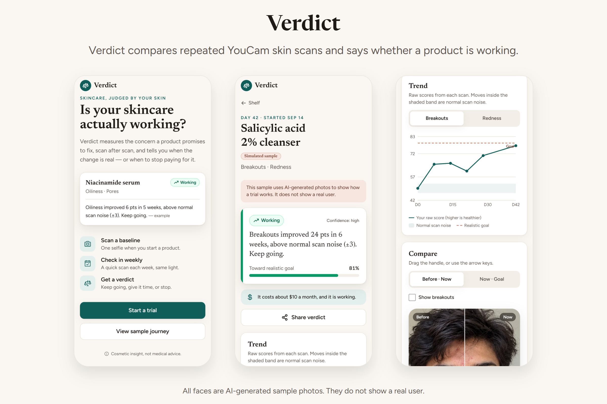

> The sample journey in these screenshots uses AI-generated photos to show how a trial works. It does not show a real user.

## How it uses the YouCam API

| YouCam API | How Verdict uses it |
|---|---|
| **AI Skin Analysis (v2, SD, all 16 concerns)** | Every check-in scan returns a raw score and a user-facing score for 15 concerns, plus the overall score, skin age, skin type and a heatmap mask for each concern. Verdict stores these results on the device and compares them over time. |
| **AI Skin Simulation** | When a trial starts, Verdict simulates a realistic improvement (intensity 0.4) for the concerns the user is tracking. |
| **AI Skin Analysis on the simulated image** | Verdict uploads the simulated image again and analyzes it. The result is a numeric goal score, so the app can show how far the user has moved toward a realistic outcome. |

The confirmed request and response formats are documented in [docs/youcam-api-notes.md](docs/youcam-api-notes.md).

## How the verdict is decided

The verdict engine is a pure TypeScript function in [lib/verdict/engine.ts](lib/verdict/engine.ts). It has a unit test for every rule.

- It uses `raw_score`, because the documentation says `ui_score` is adjusted upward to be encouraging.
- The baseline is the average of scans taken before the start date or within the first three days.
- Changes smaller than the noise band (3 raw points by default, or wider if the user's own baseline scans vary more) count as no change. In our test, re-framing the same photo changed scores by at most 1 point.
- Each concern has a fair-verdict window based on the roughly 28-day skin cycle. For example, hydration has 2 weeks, oiliness has 4 weeks, breakouts have 6 weeks and fine lines have 12 weeks. These windows are heuristics, and the app labels them as such.
- If a tracked concern gets worse, or if redness or breakouts get clearly worse, the verdict is **Pause**. This check runs first so that possible irritation is shown even in the first week.
- If two products target the same concern at the same time, the app warns that their effects cannot be separated.

## Features

- **Trial setup:** The user names the product, chooses up to three concerns and sets the start date, which can be in the past. The price is optional.
- **Camera check-in:** The front camera shows an oval guide and checks the light before capture. The previous photo is shown faintly over the camera, so each check-in uses the same framing. If the camera is not available, the user can choose a photo instead.
- **Price and money saved:** With a price and how long one bottle lasts, the trial shows the monthly cost in US dollars. When the verdict is Not moving or Pause, it shows how much stopping would save each month.
- **Share the verdict:** A Share button turns the verdict into an image (without any face photo) and opens the phone's share menu, or downloads the image on a computer.
- **Install as an app:** Verdict can be added to the home screen and opens full screen. Saved trials, reports and the sample journey open offline; scanning needs a connection, and the app says so.
- **Import of past selfies:** Photos are dated from their EXIF data or by the user. Photos that were already imported are skipped before any API call, so no units are wasted.
- **Realistic goal preview:** A before-and-goal comparison built with Skin Simulation.
- **Trial detail:** The verdict with its reason and confidence, a trend chart with the noise band and the goal line, a before-and-now comparison with the concern heatmap, a side-effect watch and the list of check-ins.
- **Skin report:** All concern scores for one scan. Tapping the eye on a row shows that concern's heatmap; the eye shows a slash while the map is visible.
- **Managing data:** The user can delete a scan, archive a trial, or reset all data from the shelf. Each action asks for confirmation inside the page.
- **Unit protection:** Retried requests never create a second paid task, duplicate photos are refused before upload, and each visitor has a daily scan limit.
- **Simulated sample journey:** A six-week trial made from AI-generated photos and analyzed with the real YouCam API. It is labeled as a simulated sample in the app, so it is never presented as a real user.
- **Privacy:** Photos, scores and trials are stored only in the browser (IndexedDB). The server forwards requests to YouCam and stores nothing about the user.

## Running the project

Requirements: Node.js 20 or newer.

```bash
npm install
cp .env.example .env.local   # then add your YouCam API key
npm run dev                  # http://localhost:3000
```

| Variable | Purpose |
|---|---|
| `YOUCAM_API_KEY` | Your YouCam API key. It is only used on the server. |
| `YOUCAM_BASE_URL` | The API host. The default is `https://yce-api-01.makeupar.com`. |
| `YOUCAM_MOCK` | Set to `1` to use recorded responses and spend no API units. |
| `SCAN_LIMIT_PER_IP_PER_DAY` | The number of scans and simulations one visitor (IP address) may run per day. The default is 10. Each server instance counts separately, so this is a best-effort guard for a public demo link. |

To try the app without an API key or units, run:

```bash
npm run dev:mock
```

Mock mode returns recorded YouCam responses from `fixtures/youcam/`. A camera needs HTTPS or `localhost`; on other addresses the app offers a file picker instead.

## Deploying

The app is designed for [Vercel](https://vercel.com). Import this repository, set `YOUCAM_API_KEY` and `YOUCAM_BASE_URL` (and optionally `SCAN_LIMIT_PER_IP_PER_DAY`), and deploy. The phone camera needs HTTPS, which Vercel provides. Photos are reduced to 4 MB or less before upload, which keeps requests under Vercel's 4.5 MB body limit.

## Screenshots

| Start | Verdict | Trend |
|---|---|---|
| 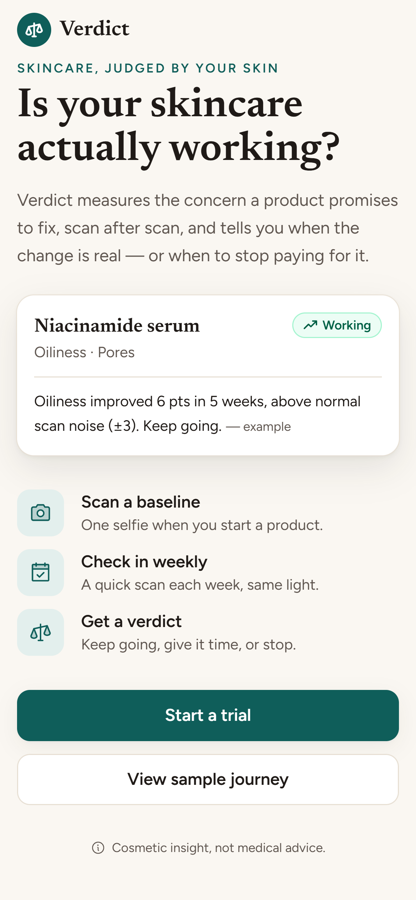 | 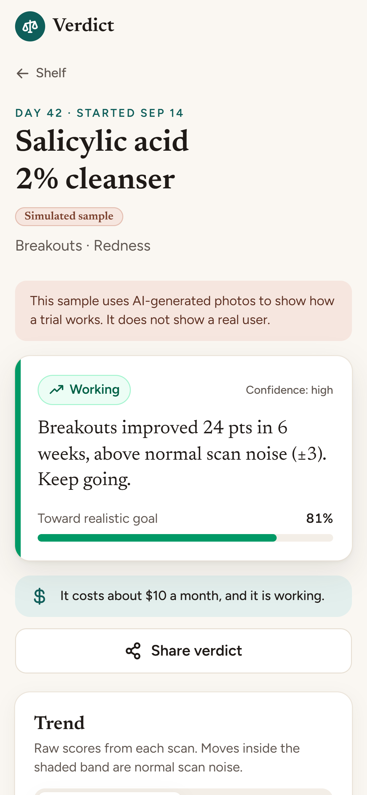 | 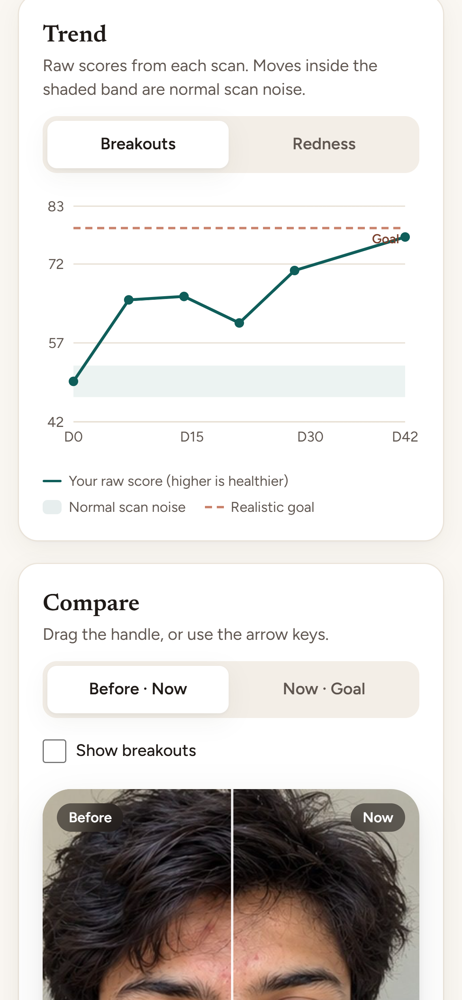 |
| **Heatmap comparison** | **Realistic goal** | **Skin report** |
| 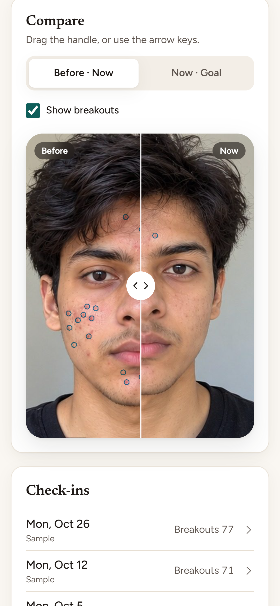 | 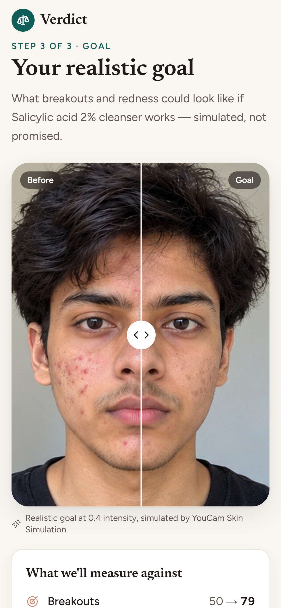 | 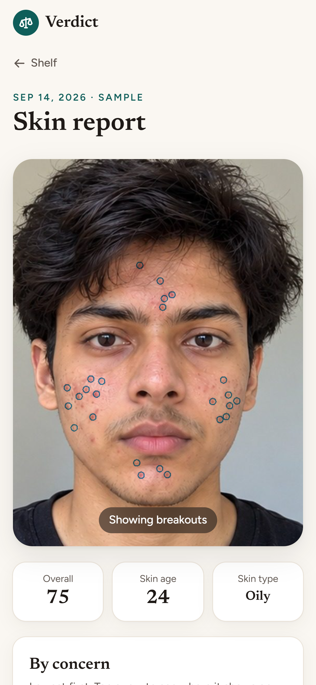 |
| **Shelf** | **New trial** | **Check-in** |
| 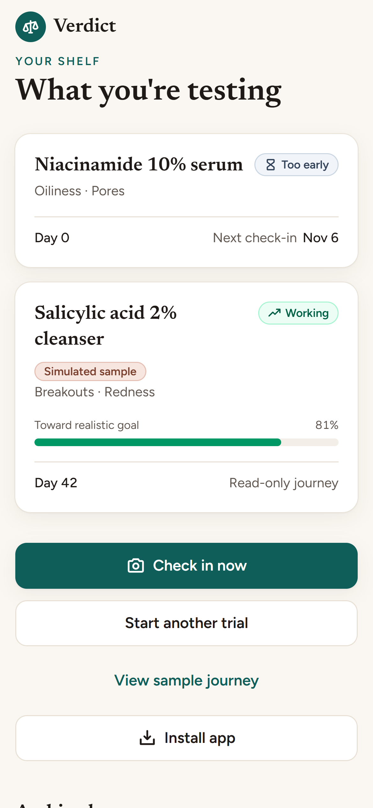 | 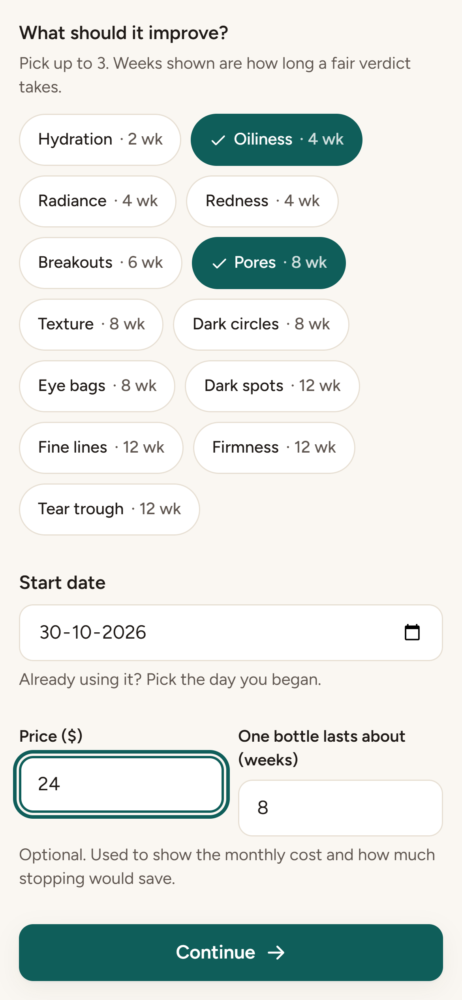 | 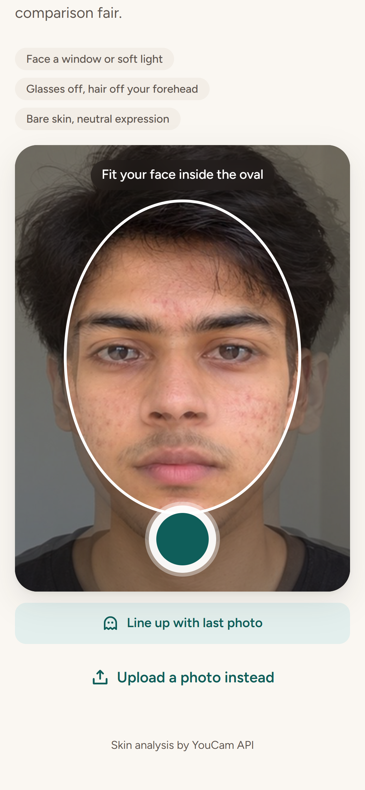 |

Gallery images in a 3:2 ratio are in [docs/screenshots/](docs/screenshots/):

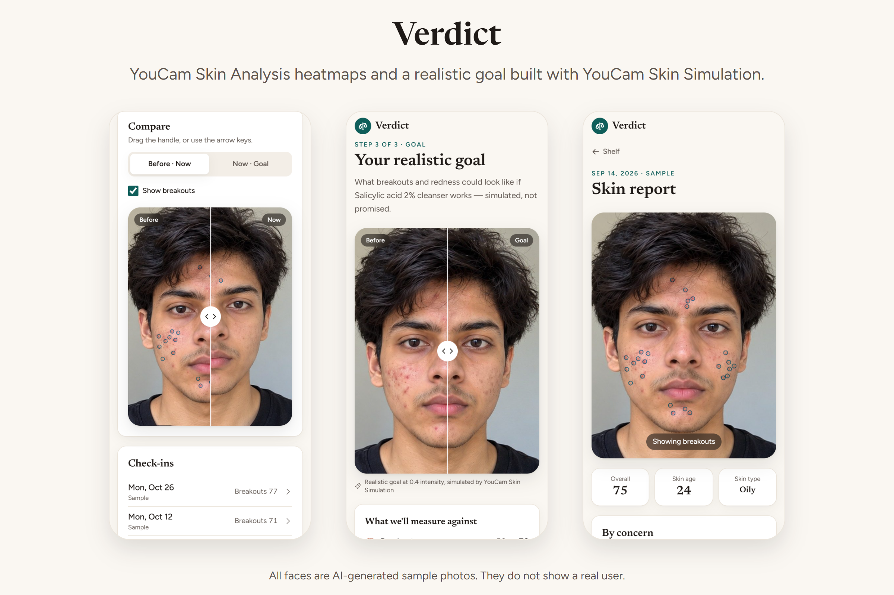

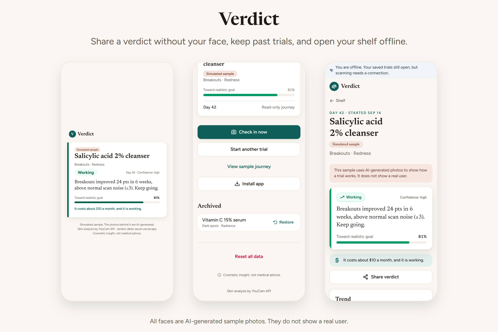

## Tests and checks

```bash
npm test        # Vitest unit and component tests
npm run lint
npm run build
```

The tests never call the real API.

## Scripts

- `npm run spike` runs the live API check that produced `fixtures/youcam/` and `docs/youcam-api-notes.md`. It uses about 45 units.
- `npm run record-sample -- --product "<name>" --concerns oiliness,pore --start YYYY-MM-DD --consent` records the bundled sample journey from consented, dated selfies in `.local/sample/`. It uses 16 units per photo plus 13 units for the goal.

## Project structure

```
app/                 Pages (shelf, new trial, scan, scan report, trial detail, goal, import) and API routes
app/api/             Server proxy to YouCam: /api/scan, /api/simulate, /api/asset
components/          UI components (verdict card, trend chart, compare slider, camera)
lib/verdict/         Concern catalog and verdict engine
lib/youcam/          YouCam client, mock client, error messages, asset allowlist
lib/scan/            Client-side scan, goal and import flows
lib/store/           IndexedDB storage
tests/               Vitest tests
docs/                API notes and screenshots
```

## Limitations

- The phone camera has not yet been tested on a real device.
- The noise band and the fair-verdict windows are reasoned defaults. They have not yet been validated with real users over several weeks.
- Lighting differences between check-ins can move scores. The app asks for the same light each time and blocks capture when the frame is too dark.
- Data stays in one browser. Clearing site data, or "Reset all data" on the shelf, removes the history.
- The daily scan limit is kept in server memory, so each Vercel instance counts separately.

## License

[MIT](LICENSE)
